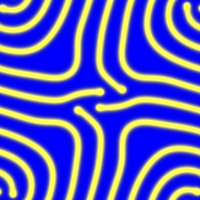
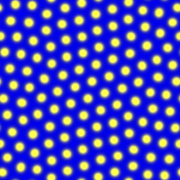
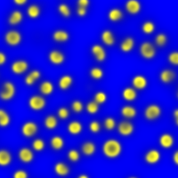

# Morphogenesis

A small C++ / [raylib](https://www.raylib.org/) simulator of the **Gray-Scott reaction-diffusion model** — two virtual chemicals that feed, kill, and diffuse across a 2D grid, spontaneously forming spots, stripes, and labyrinthine patterns reminiscent of animal coats, coral, and slime mold.

<p align="center">
  
  
  
</p>

## Background

The idea that chemical reaction and diffusion alone could generate spatial pattern goes back to Alan Turing's 1952 paper [*The Chemical Basis of Morphogenesis*](https://royalsocietypublishing.org/doi/10.1098/rstb.1952.0012). Turing showed that a pair of diffusing, reacting substances (an *activator* and an *inhibitor*) can be linearly unstable to small perturbations, so a nearly uniform state breaks into stable stripes, spots, and waves by following a set of simple equations.

This project implements the **Gray-Scott model**, a particular two-species feed-diffuse-react system. The reference for both the model and the parameter regimes used here is John E. Pearson's 1993 paper [*Complex Patterns in a Simple System*](https://www.science.org/doi/10.1126/science.261.5118.189) (Science, 261(5118), 189–192), which explored the patterns that emerge from this compact set of equations.

## How it works

Two concentration fields, `A` and `B`, live on a 2D grid and are updated with an explicit (forward Euler) scheme:

```
∂A/∂t = Dₐ ∇²A − AB² + f(1 − A)
∂B/∂t = D_b ∇²B + AB² − (f + k)B
```

- `AB²` is the reaction: B autocatalytically consumes A.
- `f` (feed) and `k` (kill) are the control parameters — the pattern you get depends almost entirely on them.
- `Dₐ = 1.0`, `D_B = 0.5`: B diffuses slower than A, the ingredient Turing identified as essential for instability.

Implementation notes:

- **9-point Laplacian** with weights `0.20` for orthogonal neighbours and `0.05` for diagonals (centre `-1.0`), which is more isotropically accurate than the 5-point stencil.
- **Periodic boundary conditions** (the grid wraps like a torus), implemented as a branch-free interior loop plus a separate border pass, so the hot path stays vectorizable.
- Fields are stored as **flat `float` arrays** for contiguous memory access, and several simulation steps run per rendered frame.

## Building

Requires a C++17 compiler and [raylib](https://github.com/raysan5/raylib) (developed on Windows with g++/MinGW).

```sh
make
```

which is equivalent to:

```sh
g++ -O3 -ffast-math -march=native -flto -Wall -std=c++17 main.cpp -o morphogenesis.exe -lraylib -lgdi32 -lwinmm
```

## Usage

### Interactive mode

Run with no arguments to open a window (defaults: `f = 0.098`, `k = 0.057`):

```sh
./morphogenesis.exe
```

| Key        | Action                     |
|------------|----------------------------|
| `Up` / `+` | Increase simulation steps per frame |
| `Down` / `-` | Decrease simulation steps per frame |
| close window | Quit                     |

### Headless mode

Run the simulation without a window and export the final state as a PNG — useful for parameter exploration and for producing reproducible images:

```sh
./morphogenesis.exe --headless --f 0.0367 --k 0.0649 --steps 40000 --seed square --out mitosis.png
```

| Flag               | Default       | Description                                   |
|--------------------|---------------|-----------------------------------------------|
| `--headless`       | off           | Run without a window and export a PNG         |
| `--f <value>`      | `0.098`       | Feed rate                                     |
| `--k <value>`      | `0.057`       | Kill rate                                     |
| `--steps <n>`      | `40000`       | Number of simulation steps to run             |
| `--seed square`    | `square`      | Seed a single square of B in the centre       |
| `--seed noise`     |               | Seed random scattered patches (deterministic) |
| `--out <file.png>` | `output.png`  | Output image path                             |

## Examples

Each image below is a headless run; the feed/kill pair determines the regime (Pearson, 1993):

**Worms / labyrinth** — `f = 0.058`, `k = 0.065`, 60 000 steps


**Mitosis** — `f = 0.0367`, `k = 0.0649`, 40 000 steps. Spots divide and replicate until they pack the space.


**Localized spots** — `f = 0.014`, `k = 0.054`, 120 000 steps (noise seed). Spots grow rings and slowly proliferate.


**Self-replicating structure** — `f = 0.078`, `k = 0.061`, 150 000 steps (square seed). A single seed splits and folds into an elaborate blob.


## References

1. Turing, A. M. (1952). *The Chemical Basis of Morphogenesis*. Philosophical Transactions of the Royal Society B, 237(641), 37–72. <https://royalsocietypublishing.org/doi/10.1098/rstb.1952.0012>
2. Pearson, J. E. (1993). *Complex Patterns in a Simple System*. Science, 261(5118), 189–192. <https://www.science.org/doi/10.1126/science.261.5118.189>
